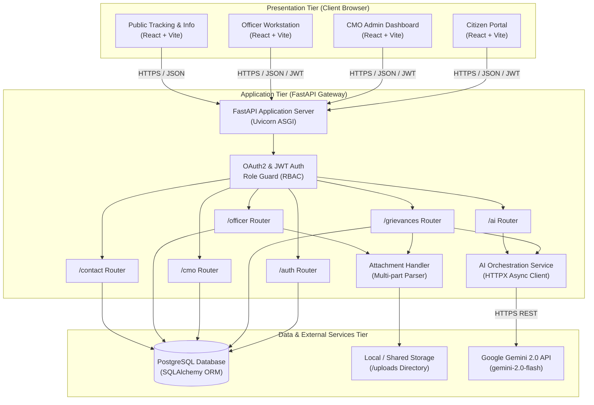
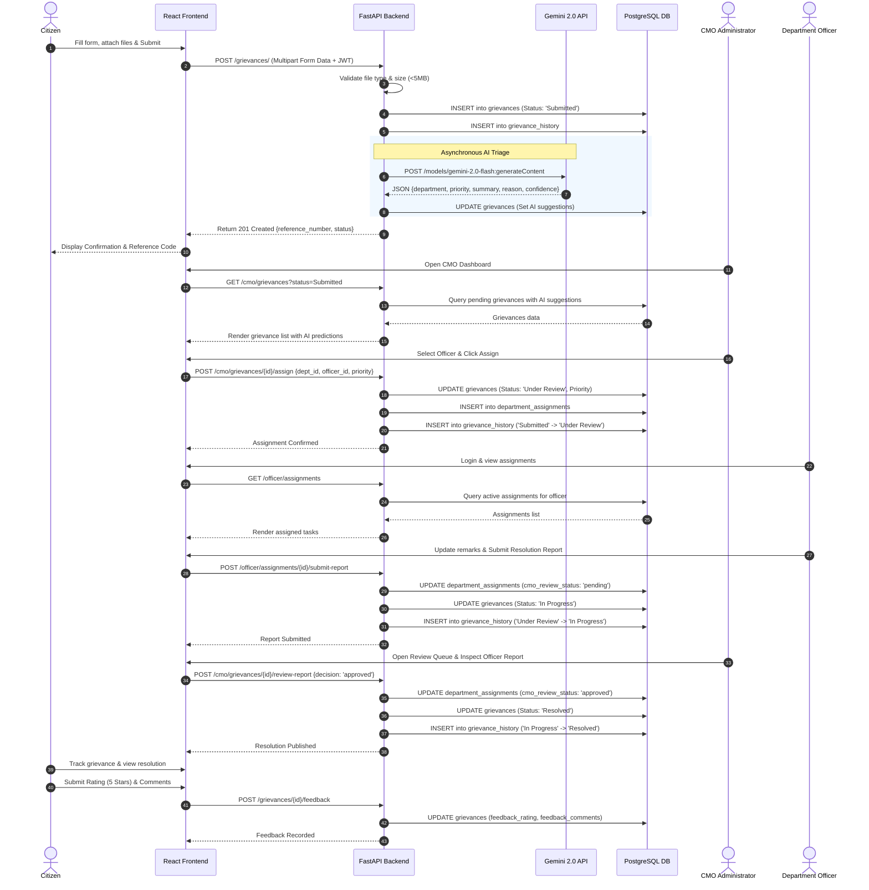

# System Architecture — CM Kerala Grievance Redressal Portal

This document details the architectural topology, component interactions, and end-to-end request flows of the CM Kerala Public Grievance Redressal Portal.

---

## 1. High-Level 3-Tier Architecture

The system is designed around a decoupled, three-tier architecture ensuring modularity, high scalability, and robust security:

1. **Presentation Tier (Frontend)**: Single Page Application (SPA) built with React and Vite, delivering high responsiveness, client-side route protection, and accessible government UI layouts.
2. **Application Tier (Backend API)**: Asynchronous RESTful service built with FastAPI, handling authentication, business logic, role-based authorization, file streaming, and AI orchestration.
3. **Data Tier (Persistence & Intelligence)**:
   - **PostgreSQL 14+**: Relational database handling ACID transactions, relational integrity, indexing, and audit history.
   - **Google Gemini 2.0 API**: External generative AI service for natural language complaint analysis and triaging.
   - **File System / Object Storage**: Media storage for uploaded citizen evidence and officer reports.

---

## 2. Request Flow Sequence: Grievance Lifecycle

The following sequence diagram outlines the entire lifecycle of a citizen grievance: from submission and AI analysis to officer action and CMO approval.

---

## 3. Component Deep Dive

### 3.1 Presentation Layer (Frontend)
- **Vite Bundler**: Ensures sub-second hot module reloading (HMR) and optimized static asset chunking.
- **State Management**:
  - `AuthContext`: Centralized React context storing the JWT token, decoded user profile, and session state persisted in `localStorage`.
  - Component-level state with `useState` and `useEffect` for data fetching, dynamic filters, and pagination.
- **Design Tokens**: Standardized CSS custom properties in `index.css` guarantee visual consistency across portals without third-party CSS overhead.
- **Route Guards**: `ProtectedRoute` component intercepts unauthorized navigation and evaluates allowed role matrices before rendering protected view trees.

### 3.2 Application Layer (FastAPI Backend)
- **Asynchronous Architecture**: Leverages Python's `asyncio` loop to serve concurrent requests with high throughput.
- **Pydantic Validation**: Strong request/response typing prevents malformed inputs and automatic serialization errors.
- **Security & Password Hashing**:
  - Bcrypt algorithm via `passlib` protects stored credentials.
  - Signed JWT tokens (`HS256`) with configurable expiration enforce stateless authentication.
- **File Upload Engine**: Enforces whitelist checks against MIME types (`image/jpeg`, `image/png`, `application/pdf`, docx) and enforces a strict 5 MB file size boundary.

### 3.3 Persistence Layer (PostgreSQL)
- **Relational Integrity**: Foreign key constraints cascade appropriately to maintain integrity across grievances, historical logs, and department assignments.
- **Indexing Strategy**:
  - Unique index on `users.email`.
  - Unique index on `departments.code`.
  - Unique and query-optimized index on `grievances.reference_number`.
  - Foreign key indexing on `grievances.citizen_id`, `department_assignments.officer_id`, and `grievance_history.grievance_id`.

### 3.4 Intelligence Layer (Gemini AI Service)
- **Provider**: Google Generative AI via HTTP REST API (`https://generativelanguage.googleapis.com/v1beta`).
- **Model**: `gemini-2.0-flash`.
- **Fault-Tolerance**:
  - Graceful fallback: If the external API times out, fails rate limiting (HTTP 429), or receives malformed data, the grievance is saved successfully with clear error indicators.
  - Manual Retry: CMO administrators have an explicit `/ai/analyze/{id}/retry` endpoint to re-trigger analysis on demand.
