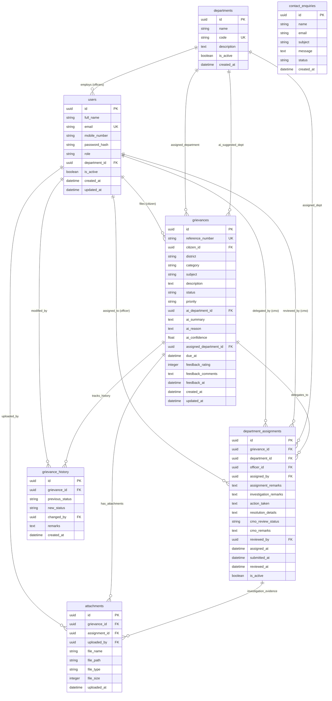

# Database Design — CM Kerala Grievance Redressal Portal

This document provides a comprehensive specification of the relational database schema powering the CM Kerala Grievance Redressal Portal.

---

## 1. Entity-Relationship Diagram (ERD)

The database consists of **7 relational tables** modeled in PostgreSQL, supporting UUID primary keys, foreign key constraints, and relational history tracking.

---

## 2. Table Specifications

### 2.1 Table: `users`
Stores user identities, hashed credentials, and role assignments for Citizens, CMO Administrators, and Department Officers.

| Column | Type | Nullable | Constraints & Defaults | Description |
| :--- | :--- | :--- | :--- | :--- |
| `id` | `UUID` | No | Primary Key, `uuid_generate_v4()` | Unique identifier for user |
| `full_name` | `VARCHAR(255)` | No | — | User's legal full name |
| `email` | `VARCHAR(255)` | No | Unique, Indexed | Login email address |
| `mobile_number` | `VARCHAR(20)` | Yes | — | Contact phone number |
| `password_hash` | `VARCHAR(255)` | No | — | Bcrypt hashed password |
| `role` | `VARCHAR(20)` | No | `'citizen'`, `'cmo_admin'`, `'officer'` | RBAC role |
| `department_id` | `UUID` | Yes | FK -> `departments.id` | Department for officers; NULL for citizens & CMO |
| `is_active` | `BOOLEAN` | No | Default `TRUE` | Account active flag |
| `created_at` | `TIMESTAMP` | No | Default `CURRENT_TIMESTAMP` | Account creation timestamp |
| `updated_at` | `TIMESTAMP` | No | Default `CURRENT_TIMESTAMP` | Last profile update timestamp |

---

### 2.2 Table: `departments`
Master directory of Government of Kerala administrative departments handling public grievances.

| Column | Type | Nullable | Constraints & Defaults | Description |
| :--- | :--- | :--- | :--- | :--- |
| `id` | `UUID` | No | Primary Key, `uuid_generate_v4()` | Unique identifier for department |
| `name` | `VARCHAR(255)` | No | — | Official department title (e.g., Public Works Department) |
| `code` | `VARCHAR(50)` | No | Unique | Short uppercase alphanumeric code (e.g., PWD, HEALTH) |
| `description` | `TEXT` | Yes | — | Summary of departmental jurisdictions |
| `is_active` | `BOOLEAN` | No | Default `TRUE` | Operational status of department |
| `created_at` | `TIMESTAMP` | No | Default `CURRENT_TIMESTAMP` | Record timestamp |

---

### 2.3 Table: `grievances`
Core repository of petitions filed by citizens, holding submission details, AI triage outputs, administrative state, and citizen feedback.

| Column | Type | Nullable | Constraints & Defaults | Description |
| :--- | :--- | :--- | :--- | :--- |
| `id` | `UUID` | No | Primary Key, `uuid_generate_v4()` | Unique internal grievance ID |
| `reference_number`| `VARCHAR(50)` | No | Unique, Indexed | Human-readable tracking code (`GRV-YYYY-XXXXXX`) |
| `citizen_id` | `UUID` | No | FK -> `users.id` | Reference to authoring citizen |
| `district` | `VARCHAR(100)` | No | — | One of the 14 districts of Kerala |
| `category` | `VARCHAR(100)` | No | — | Grievance categorization |
| `subject` | `VARCHAR(500)` | No | — | Brief subject line / title |
| `description` | `TEXT` | No | — | Detailed narrative of the grievance |
| `status` | `VARCHAR(20)` | No | Default `'Submitted'` | Status: `Submitted`, `Under Review`, `In Progress`, `Resolved`, `Reopened` |
| `priority` | `VARCHAR(20)` | Yes | `'Low'`, `'Medium'`, `'High'` | Urgency priority |
| `ai_department_id`| `UUID` | Yes | FK -> `departments.id` | AI recommended department |
| `ai_summary` | `TEXT` | Yes | — | AI-generated executive summary |
| `ai_reason` | `TEXT` | Yes | — | AI reasoning rationale |
| `ai_confidence` | `FLOAT` | Yes | `0.0` to `1.0` | AI prediction confidence score |
| `assigned_department_id` | `UUID` | Yes | FK -> `departments.id` | Official department confirmed by CMO |
| `due_at` | `TIMESTAMP` | Yes | — | Target deadline for resolution |
| `feedback_rating`| `INTEGER` | Yes | Check `1` to `5` | Citizen satisfaction score (1 to 5 stars) |
| `feedback_comments` | `TEXT` | Yes | — | Qualitative citizen feedback |
| `feedback_at` | `TIMESTAMP` | Yes | — | Timestamp when feedback was logged |
| `created_at` | `TIMESTAMP` | No | Default `CURRENT_TIMESTAMP` | Submission timestamp |
| `updated_at` | `TIMESTAMP` | No | Default `CURRENT_TIMESTAMP` | Last updated timestamp |

---

### 2.4 Table: `grievance_history`
Immutable chronological audit log capturing every state transition and officer action across the grievance lifecycle.

| Column | Type | Nullable | Constraints & Defaults | Description |
| :--- | :--- | :--- | :--- | :--- |
| `id` | `UUID` | No | Primary Key, `uuid_generate_v4()` | Unique history log ID |
| `grievance_id` | `UUID` | No | FK -> `grievances.id` | Target grievance |
| `previous_status` | `VARCHAR(20)` | Yes | — | State before update (NULL for initial creation) |
| `new_status` | `VARCHAR(20)` | No | — | New state after update |
| `changed_by` | `UUID` | No | FK -> `users.id` | User identity performing the action |
| `remarks` | `TEXT` | Yes | — | Descriptive action log or administrative justification |
| `created_at` | `TIMESTAMP` | No | Default `CURRENT_TIMESTAMP` | Exact timestamp of status alteration |

---

### 2.5 Table: `department_assignments`
Manages task assignments from CMO to department officers, capturing investigation remarks, action taken, and CMO report reviews.

| Column | Type | Nullable | Constraints & Defaults | Description |
| :--- | :--- | :--- | :--- | :--- |
| `id` | `UUID` | No | Primary Key, `uuid_generate_v4()` | Unique assignment identifier |
| `grievance_id` | `UUID` | No | FK -> `grievances.id` | Grievance being delegated |
| `department_id` | `UUID` | No | FK -> `departments.id` | Receiving department |
| `officer_id` | `UUID` | No | FK -> `users.id` | Designated investigating officer |
| `assigned_by` | `UUID` | No | FK -> `users.id` | CMO administrator authorising assignment |
| `assignment_remarks` | `TEXT` | Yes | — | Directives or guidelines issued by CMO |
| `investigation_remarks` | `TEXT` | Yes | — | Officer's ongoing findings from the field |
| `action_taken` | `TEXT` | Yes | — | Tangible corrective actions implemented |
| `resolution_details` | `TEXT` | Yes | — | Officer's final closing remarks in report |
| `cmo_review_status` | `VARCHAR(20)`| Yes | `'pending'`, `'approved'`, `'rejected'`, `'further_action'` | Status of CMO's review on officer's report |
| `cmo_remarks` | `TEXT` | Yes | — | Feedback or directives given during CMO review |
| `reviewed_by` | `UUID` | Yes | FK -> `users.id` | CMO admin who reviewed the report |
| `assigned_at` | `TIMESTAMP` | No | Default `CURRENT_TIMESTAMP` | Delegation timestamp |
| `submitted_at` | `TIMESTAMP` | Yes | — | Timestamp when officer submitted final report |
| `reviewed_at` | `TIMESTAMP` | Yes | — | Timestamp when CMO completed review |
| `is_active` | `BOOLEAN` | No | Default `TRUE` | Whether this is the active assignment for the grievance |

---

### 2.6 Table: `attachments`
Stores metadata and filesystem pointers for evidence documents attached by citizens or officers.

| Column | Type | Nullable | Constraints & Defaults | Description |
| :--- | :--- | :--- | :--- | :--- |
| `id` | `UUID` | No | Primary Key, `uuid_generate_v4()` | Unique attachment identifier |
| `grievance_id` | `UUID` | No | FK -> `grievances.id` | Associated grievance |
| `assignment_id` | `UUID` | Yes | FK -> `department_assignments.id` | Associated assignment (if uploaded by officer) |
| `uploaded_by` | `UUID` | No | FK -> `users.id` | Uploader identity |
| `file_name` | `VARCHAR(255)`| No | — | Original file name |
| `file_path` | `VARCHAR(500)`| No | — | Relative path on disk (under `/uploads/`) |
| `file_type` | `VARCHAR(100)`| No | — | MIME content type (e.g. `image/jpeg`, `application/pdf`) |
| `file_size` | `INTEGER` | No | — | File size in bytes (max 5,242,880) |
| `uploaded_at` | `TIMESTAMP` | No | Default `CURRENT_TIMESTAMP` | Upload timestamp |

---

### 2.7 Table: `contact_enquiries`
Captures general public inquiries and feedback submitted via the public contact form.

| Column | Type | Nullable | Constraints & Defaults | Description |
| :--- | :--- | :--- | :--- | :--- |
| `id` | `UUID` | No | Primary Key, `uuid_generate_v4()` | Unique enquiry record ID |
| `name` | `VARCHAR(255)`| No | — | Sender name |
| `email` | `VARCHAR(255)`| No | — | Sender email address |
| `subject` | `VARCHAR(500)`| No | — | Enquiry subject |
| `message` | `TEXT` | No | — | Full enquiry text |
| `status` | `VARCHAR(20)` | No | Default `'new'` | Enquiry workflow state (`'new'`, `'read'`, `'responded'`) |
| `created_at` | `TIMESTAMP` | No | Default `CURRENT_TIMESTAMP` | Timestamp of submission |
