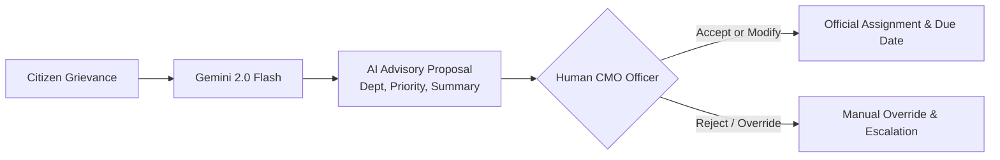

# AI Integration Guide — CM Kerala Grievance Redressal Portal

This document outlines the architecture, system prompts, output schemas, failure handling, and ethical safeguards governing artificial intelligence within the CM Kerala Grievance Redressal Portal.

---

## 1. Overview & Provider Details

The portal integrates Large Language Model (LLM) intelligence to assist the Chief Minister's Office (CMO) in rapidly cataloging, summarizing, prioritizing, and routing thousands of incoming citizen petitions.

- **AI Provider**: Google Generative AI (Google DeepMind)
- **Model Selected**: `gemini-2.0-flash`
- **Protocol**: Direct HTTPS REST integration (`https://generativelanguage.googleapis.com/v1beta/models/gemini-2.0-flash:generateContent`)
- **Execution Mode**: Asynchronous background dispatch via Python `httpx.AsyncClient`
- **Cost Tier**: Free tier quota compliant

---

## 2. Architectural Philosophy: Human-in-the-Loop Safeguards

> [!IMPORTANT]
> **GOVERNANCE SAFEGUARD: ADVISORY ONLY**
> Artificial Intelligence in this system operates strictly as an **administrative advisory assistant**. The AI **never** makes unilateral decisions, never officially assigns a case to a department or officer, and never closes or rejects a grievance. 

All AI outputs are stored in dedicated advisory fields (`ai_department_id`, `ai_summary`, `ai_reason`, `ai_confidence`) alongside the grievance. A human CMO administrator must review the suggestions and explicitly choose to accept, modify, or override the recommendations.



---

## 3. System Prompt & Prompt Engineering

The system prompt is strictly constrained to prevent hallucinations, enforce domain-valid departments, and output pristine machine-readable JSON without extraneous prose.

### System Prompt Specification
```python
VALID_DEPARTMENTS = [
    "Public Works Department",
    "Health Department",
    "Education Department",
    "Revenue Department",
    "Police Department",
    "Transport Department",
    "Water Resources Department",
    "Agriculture Department",
    "Housing Department",
    "Labour Department",
]

SYSTEM_PROMPT = f"""You are a government grievance analysis assistant for the Chief Minister of Kerala's office.
Analyze the citizen complaint and return ONLY a valid JSON object (no markdown, no extra text) with these fields:
- "department": one of {json.dumps(VALID_DEPARTMENTS)}
- "category": a specific sub-category string (e.g., "Road Maintenance", "Hospital Services", etc.)
- "priority": one of "Low", "Medium", "High"
- "summary": a 1-2 sentence summary for the CMO
- "reason": why you chose this department and priority
- "confidence": a float between 0.0 and 1.0

Example:
{{"department": "Public Works Department", "category": "Road Maintenance", "priority": "High", "summary": "Citizen reports damaged road creating safety concerns.", "reason": "Road damage with safety risks requires immediate attention from Public Works.", "confidence": 0.85}}
"""
```

### Generation Hyperparameters
- **Temperature**: `0.3` (Low temperature reduces variance, encourages factual classification, and prevents stylistic deviation).
- **Max Output Tokens**: `500` (Sufficient for concise 2-sentence summaries and rationale).
- **Format Sanitization**: Automatic parsing strips out accidental markdown code wrappers (````json ... ````).

---

## 4. Structured Output Schema

The backend maps the LLM response directly to a strongly typed Pydantic model:

```python
class AIAnalysisResult(BaseModel):
    department: str | None = None
    category: str | None = None
    priority: str | None = None
    summary: str | None = None
    reason: str | None = None
    confidence: float | None = None
    error: str | None = None
```

### Example Input
> **Subject**: Heavy waterlogging on hospital access road  
> **Description**: The primary access road leading to Taluk Hospital is submerged under 2 feet of water following recent rains. Ambulances are unable to reach the emergency entrance.

### Example AI Output
```json
{
  "department": "Public Works Department",
  "category": "Drainage & Road Access",
  "priority": "High",
  "summary": "Hospital emergency access road is flooded under 2 feet of water, blocking ambulances.",
  "reason": "Immediate danger to life and medical emergency transport necessitates urgent PWD action.",
  "confidence": 0.95,
  "error": null
}
```

---

## 5. Error Handling & Resilience

The integration includes defensive handling for real-world API anomalies:

| Failure Mode | Detection | Handling Strategy |
| :--- | :--- | :--- |
| **Missing API Key** | `not settings.AI_API_KEY` | Bypasses call immediately; returns `"AI API key not configured"`. Grievance is saved normally without blocking submission. |
| **Rate Limit / Quota Exceeded** | HTTP `429 Too Many Requests` | Returns `"AI API rate limit exceeded. Please try again later."` without throwing a 500 error. |
| **API Timeout** | `httpx.TimeoutException` (> 30s) | Catches timeout; logs notice; leaves AI fields blank for human triage. |
| **Malformed JSON Output** | `json.JSONDecodeError` | Catches parsing exception; returns `"AI returned invalid JSON response"`. |
| **Manual Retry Capability** | `POST /ai/analyze/{id}/retry` | Exposes dedicated CMO admin endpoint to re-invoke analysis on grievances that initially failed. |

---

## 6. Limitations & Boundary Conditions

1. **Language & Dialect**: Current prompts are optimized for English and transliterated Malayalam. Non-standard regional Malayalam scripts may yield lower confidence scores.
2. **Multi-Departmental Petitions**: Grievances containing multiple unrelated complaints (e.g., street lights not working AND teacher shortage in local school) will be categorized under the primary dominant issue identified by the LLM.
3. **Sensitive Legal Allegations**: AI does not assess legal guilt or liability; its role is purely preliminary departmental triage.
